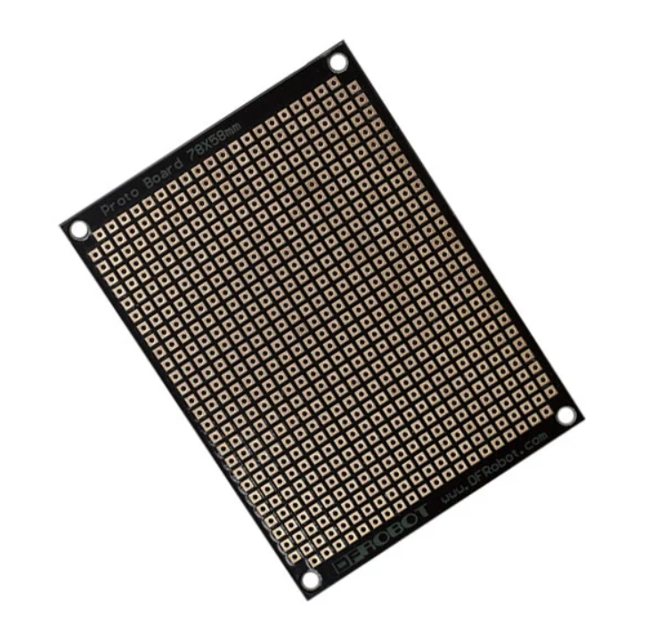

# NMOS Power Switching Interface for Electromagnetic Relays — KiCad PCB & MicroWind IC Layout

## Overview
End-to-end power electronics & microelectronics design of an optically isolated NMOS switching driver for electromagnetic relays:
- **Board-Level Design (KiCad):** Optocoupler galvanic isolation, freewheeling flyback diode protection, gate drive sizing, DRC verification, and Gerber top/bottom routing.
- **Silicon-Level Design (MicroWind — ENSAT Design Kit):** Custom NMOS transistor sizing (`W/L`), physical mask layout (`media/Microwind.png`), and `Ids-Vds` ON/OFF switching characterization.
